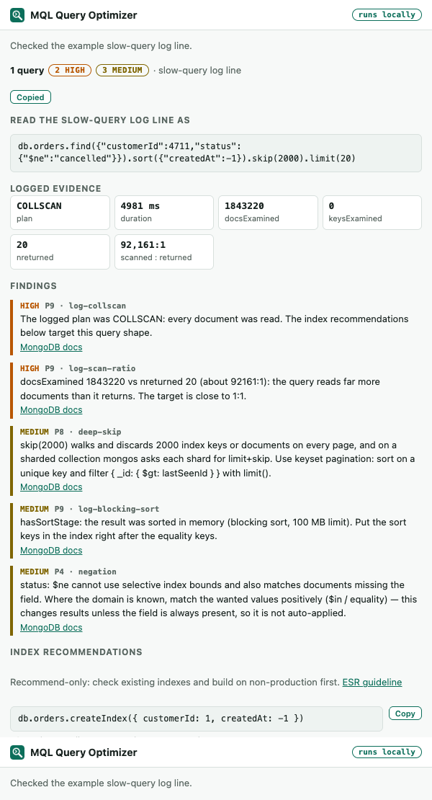

# MQL Query Optimizer — Chrome extension

Highlight a MongoDB query in a case, a ticket, a log viewer or a chat thread, then click the extension.
You get the optimizer's findings, the safe rewrites already applied, the indexes to recommend, and a
**Copy as Markdown** button that puts a ready-to-paste case note on your clipboard.



## What you can highlight

| Input | Example |
|---|---|
| mongosh query | `db.orders.find({ status: "A" }).sort({ createdAt: -1 }).skip(2000)` |
| aggregation pipeline | `db.events.aggregate([{ $addFields: … }, { $match: … }])` |
| **slow-query log line** (mongod/mongos JSON log) | `{"t":{…},"msg":"Slow query","attr":{"ns":"shop.orders","command":{"find":"orders",…},"planSummary":"COLLSCAN",…}}` — several lines at once work |
| `getMore` log line | uses the line's `originatingCommand` |
| profiler entry (`system.profile`) | `{ "op": "update", "ns": "inventory.products", "command": { "q": …, "u": … }, "millis": 812, … }` |
| command document | `{ find: "users", filter: {…}, sort: {…}, hint: {…} }`, also `aggregate`, `count`, `distinct`, `update`, `delete`, `findAndModify` |
| bare filter or pipeline | `{ status: "A", qty: { $lt: 30 } }` or `[{ $match: … }, { $group: … }]` (collection shown as `collection`) |

For log lines and profiler entries, the recorded measurements become evidence findings (pass P9):
COLLSCAN plans, `docsExamined` ≫ `nreturned`, in-memory sorts (`hasSortStage`), disk spills
(`usedDisk`), replanning, and durations pinned at `maxTimeMS` (a timeout-bounded baseline, not real
latency).

## Use it

1. Highlight the text on the page.
2. Click the toolbar icon, press **Alt+Shift+O**, or right-click → **Optimize selected MQL**.
3. Read the findings (most severe first). **Blocking** means the query may return wrong results and the
   fix changes the result set, so it is reported, never rewritten.
4. Click **Copy as Markdown for the case**, review the note, and paste it into the case comment.
5. Confirm any recommendation with `explain("executionStats")` on representative data.

Nothing highlighted, or the page blocks extensions (chrome:// pages, the Chrome Web Store, PDF viewer)?
The popup opens an input box: paste the text there. **Ctrl/⌘+Enter** runs it.

## Privacy and permissions

- The optimizer runs **inside the extension**. It makes **no network requests**; case text never leaves
  the browser. The only links are the "MongoDB docs" references, which open public pages when you click them.
- `activeTab` + `scripting`: read the highlighted text of the current tab **only when you click** the
  extension (or use its shortcut / menu item). No host permissions, no content scripts, no access to
  pages you do not invoke it on.
- `contextMenus`: the right-click item. `storage`: `chrome.storage.session` holds the last checked input
  and the right-click handoff in memory; it is cleared when the browser closes.
- **Copy as Markdown** includes the query text you highlighted. Review it before pasting into a
  customer-visible field.

## Install

### Team rollout (recommended)

Publish the zip to the Chrome Web Store as **Private** (visible only to your Google Workspace domain) or
**Unlisted**, or have your Chrome admin force-install it with the `ExtensionInstallForcelist` policy.
Updates then reach everyone automatically.

```bash
python scripts/package_chrome_extension.py      # -> dist/mql-optimizer-chrome-<version>.zip
```

### Individual install (Load unpacked)

1. Get the folder: `editors/chrome/` from this repository, or unzip `dist/mql-optimizer-chrome-<version>.zip`.
2. Open `chrome://extensions`, turn on **Developer mode** (top right).
3. Click **Load unpacked** and choose the folder.
4. Pin the extension (puzzle-piece icon → pin) so the toolbar button is one click away.

Check the shortcut at `chrome://extensions/shortcuts` if Alt+Shift+O is taken.

## Limits

- Static analysis: it does not know collection size, value distribution or existing indexes. A
  recommended index may already exist. Every impact claim needs `explain()` to confirm it.
- Editors that virtualize text (Monaco, some CodeMirror setups) expose only the visible part of a
  selection to the page. Use the editor's copy, then paste into the popup.
- Selections over 200,000 characters are truncated.

## Development

The rules are a JavaScript port of the Python reference in `mdbx/mql/optimize.py` and `normalize.py`.
Golden files pin the Python output, and the port must match them exactly.

```bash
cd editors/chrome && npm test                       # 37 tests: parity with every golden + UI units
python scripts/gen_optimizer_golden.py              # after changing the Python rules, regenerate goldens
.venv/bin/pytest -q tests/test_js_parity.py         # Python vs JS on ~400 inputs incl. half-typed ones
PLAYWRIGHT=/path/to/node_modules/playwright node test/e2e.mjs screenshot.png   # real-Chromium check
python scripts/make_chrome_icons.py                 # regenerate icons
python scripts/check_chrome_doc_links.py            # docs links still resolve (network)
```

Change a rule in Python first, regenerate goldens, then port the change to `lib/optimize.js` until
`npm test` passes. Bump `version` in both `manifest.json` and `package.json` for a release.
