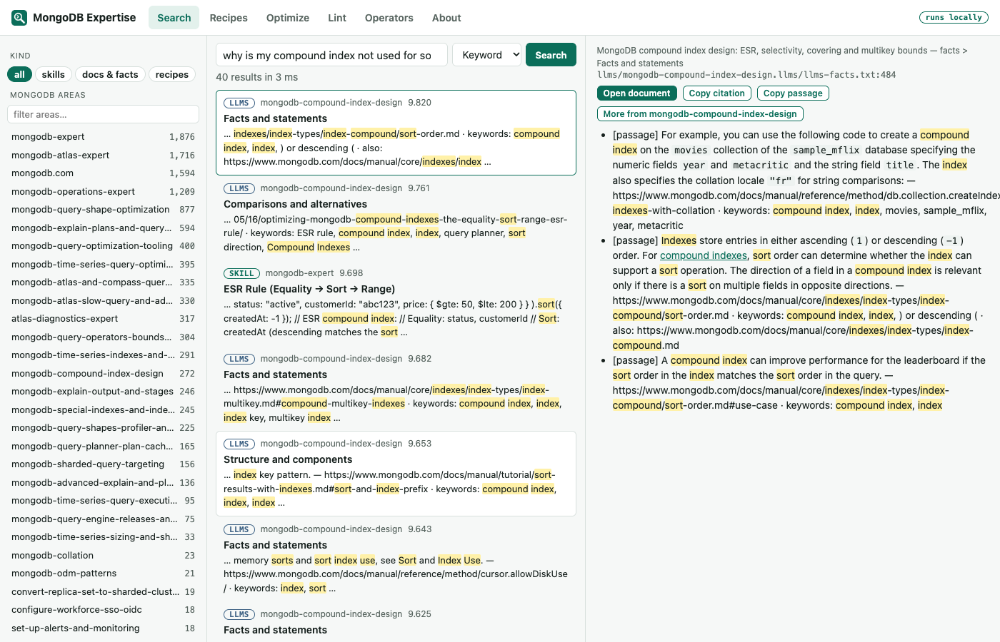
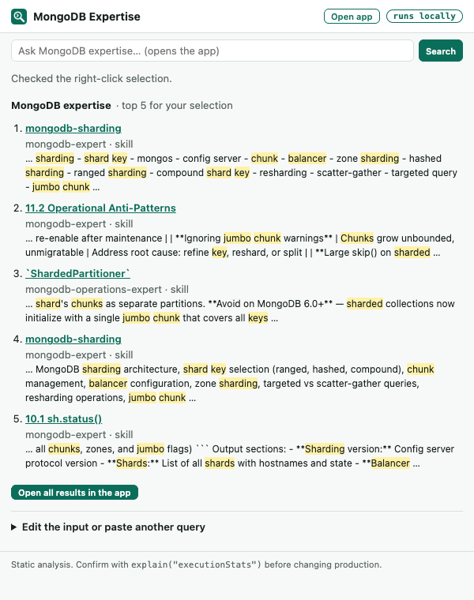

# MongoDB Expertise — Chrome extension

Everything `mdbx` does that makes sense in a browser, packaged for the TSE team and needing no Python or install
beyond the extension:

- **Search** the whole MongoDB expertise corpus (expert skills, MongoDB docs exports, 19 query-optimization
  fact packs, 25 recipes): the same BM25 ranking as `mdbx search`, filters by kind and MongoDB area,
  highlighted snippets, and full document view. Optional hybrid/semantic search with a local Ollama.
- **Optimize** a highlighted query, pipeline, slow-query log line, profiler entry or command document:
  findings, logged evidence, safe rewrites, ESR index recommendations, and a **Copy as Markdown** case note.
  Each finding links to the MongoDB docs and to the corpus page behind it.
- **Lint** MQL with the same ~25 rules as `mdbx lint` and the language server, with an outline.
- **Recipes**: step-by-step runbooks (shard a collection, Private Link, upgrades, restore, …).
- **Operators**: the reference table of ~280 MQL operators with categories and argument kinds.



## Ways in

| You want to… | Do this |
|---|---|
| Check a query or log line on the page | Highlight it → click the toolbar icon (or **Alt+Shift+O**, or right-click → **Optimize selected MQL**) |
| Look something up from a case | Highlight an error message or question → click the icon: if it is not a query, the popup shows the best corpus passages. Or right-click → **Search MongoDB expertise for “…”** |
| Search from the address bar | Type `mdb`, a space, then your question, then Enter |
| Lint a selection | Right-click → **Lint selected MQL** |
| Browse | Popup → **Open app**, or the "Ask MongoDB expertise" box in the popup |

In the app's Search tab: `/` focuses the box, `↑`/`↓` move through results, `Enter` opens the document,
`Esc` clears the area filter. Click an area on the left to search only inside it.



## What the optimizer accepts

| Input | Example |
|---|---|
| mongosh query or pipeline | `db.orders.find({ status: "A" }).sort({ createdAt: -1 }).skip(2000)` |
| slow-query log line (one or many) | `{"t":{…},"msg":"Slow query","attr":{"ns":"shop.orders","command":{"find":"orders",…},"planSummary":"COLLSCAN",…}}` |
| `getMore` log line | uses the line's `originatingCommand` |
| profiler entry | `{ "op": "update", "ns": "inventory.products", "command": { "q": …, "u": … }, "millis": 812 }` |
| command document | `{ find: "users", filter: {…}, sort: {…} }`, `aggregate`, `count`, `distinct`, `update`, `delete`, `findAndModify` |
| bare filter or pipeline | `{ status: "A" }` or `[{ $match: … }, { $group: … }]` |

Log and profiler measurements become evidence findings: COLLSCAN plans, `docsExamined` ≫ `nreturned`,
in-memory sorts, disk spills, replanning, and durations pinned at `maxTimeMS`.

## Semantic and hybrid search (optional)

Keyword search works for everyone. Hybrid and semantic search also need the query embedded with the model the
index was built with (`nomic-embed-text`), which a local Ollama provides:

1. Install Ollama and run `ollama pull nomic-embed-text`.
2. In the app: **About → Semantic and hybrid search → Enable and test**. Chrome asks for permission to reach
   `127.0.0.1` / `localhost` only.
3. Ollama rejects browser-extension origins by default (HTTP 403). The About tab shows the exact command to
   allow this extension — on macOS `launchctl setenv OLLAMA_ORIGINS "chrome-extension://<extension id>"` —
   then restart Ollama and test again.

Only the query text goes to that local Ollama; nothing leaves the machine.

## Privacy and permissions

- Search, lint and the optimizer run inside the extension and make **no network requests**.
- `activeTab` + `scripting`: read the highlighted text **only when you click** the extension, its shortcut or
  a right-click item. No host permissions, no content scripts.
- `contextMenus` (the right-click items), `storage` (`chrome.storage.session` for hand-offs and the last input,
  memory-only; `chrome.storage.local` for the Ollama setting). Optional, runtime-requested access to
  `http://127.0.0.1/*` and `http://localhost/*` for Ollama only.
- The packaged corpus is built from the **committed, redacted** corpus of this repository. Files that are not
  tracked by git (the private, local-only material) are never exported; `mdbx export-web` refuses a corpus
  outside git.
- **Copy as Markdown** includes the highlighted query text. Review it before pasting into a customer-visible field.
- The corpus contains extracts of the MongoDB documentation (CC BY-NC-SA 3.0 US) and some third-party
  sources. Distribute the extension internally (a **Private** Chrome Web Store listing for your Google
  Workspace domain, or admin force-install), not as a public listing.

## Install

### Team rollout (recommended)

```bash
python scripts/package_chrome_extension.py      # -> dist/mongodb-expertise-chrome-<version>.zip (~10 MB)
```

Upload the zip to the Chrome Web Store as a **Private** item (visible only to your Workspace domain), or have
your Chrome admin force-install it with the `ExtensionInstallForcelist` policy. Updates then reach everyone.
Options: `--no-vectors` (keyword-only, ~7 MB smaller), `--no-data` (code only; search disabled).

### Individual install (Load unpacked)

1. Run `python scripts/package_chrome_extension.py` (it writes the search data into `editors/chrome/data/`),
   or unzip `dist/mongodb-expertise-chrome-<version>.zip`.
2. Open `chrome://extensions`, turn on **Developer mode**, click **Load unpacked**, choose the folder.
3. Pin the extension (puzzle-piece icon → pin). Check `chrome://extensions/shortcuts` if Alt+Shift+O is taken.

### Auto-update an unpacked install (updates when `main` moves)

Chrome only updates Web Store / force-installed extensions by itself. For a Load-unpacked install,
`scripts/chrome_extension_autoupdate.py` is the updater:

```bash
python scripts/chrome_extension_autoupdate.py install-agent          # launchd agent, every 10 min
#   → Load unpacked once from: ~/Library/Application Support/mdbx/chrome-extension
python scripts/chrome_extension_autoupdate.py status                 # installed build vs. origin/main
python scripts/chrome_extension_autoupdate.py run --force            # rebuild + install now
python scripts/chrome_extension_autoupdate.py uninstall-agent
```

How it works: the agent fetches its own clone of the repo (`~/Library/Caches/mdbx/chrome-autoupdate/repo`);
when `origin/main` has a new commit it rebuilds the extension there (vectors included when a local Ollama is
running), swaps the runtime files into the install folder atomically, and writes `data/build.json`
(`{version, commit, built_at}`). The service worker (`lib/autoupdate.js`) re-reads that file every five minutes
and calls `chrome.runtime.reload()` when the build id changed. A push to GitHub is live in the browser within
about 15 minutes, with no clicks. Options: `--interval-min`, `--install-dir`, `--branch`, `--no-vectors`,
`--python` (an interpreter with `mdbx` + numpy; defaults to the one that ran `install-agent`).
`--source release` skips the local build and downloads the keyword-only zip CI publishes on the rolling
`chrome-latest` GitHub release (needs `gh auth login`). Settings: `~/.config/mdbx/chrome-autoupdate.json`;
log: `~/Library/Logs/mdbx-chrome-autoupdate.log`. The extension itself still makes no network requests: it only
reads its own `data/build.json`.

## Limits

- The optimizer is static: it does not know collection size, value distribution or existing indexes; confirm
  recommendations with `explain()`.
- The index is a snapshot of the corpus at packaging time; rebuild the zip after corpus updates.
- Editors that virtualize text (Monaco, some CodeMirror setups) expose only visible text to selections; copy and
  paste into the popup instead.
- The TUI, MCP server and language server are terminal/editor tools and stay in `mdbx`.

## Development

Python is the reference for everything; the JavaScript is a port pinned by golden files.

| Area | Python reference | JavaScript | Contract |
|---|---|---|---|
| Search (tokenizer, porter, BM25, hybrid) | `mdbx/webexport.py` (`WebIndex`), itself equal to SQLite FTS5 | `lib/textsearch.js`, `lib/store.js` | `tests/fixtures/search/golden.json`, `tests/test_web_search.py` |
| Optimizer + input normalization | `mdbx/mql/optimize.py`, `normalize.py` | `lib/optimize.js`, `lib/normalize.js`, `lib/parser.js` | `tests/fixtures/optimizer/*.golden.json`, `tests/test_js_parity.py` |
| Linter + operator table | `mdbx/mql/analyze.py`, `operators.py` | `lib/analyze.js`, `lib/operators*.js` | `tests/fixtures/lint/*.lint.json`, `tests/test_js_lint_parity.py` |

```bash
cd editors/chrome && npm test                      # 130 tests: parity with every golden, UI units, syntax
python scripts/gen_search_golden.py                # after changing search/export: regenerate search goldens
python scripts/gen_optimizer_golden.py             # after changing optimizer rules
python scripts/gen_lint_golden.py && python scripts/gen_chrome_operators.py   # after lint/operator changes
PLAYWRIGHT=/path/to/node_modules/playwright/index.mjs node test/e2e.mjs screenshot.png   # real Chromium
python scripts/check_chrome_doc_links.py           # docs links still resolve (network)
```

Change a rule in Python first, regenerate the goldens, port the change to JS until `npm test` passes. Bump
`version` in both `manifest.json` and `package.json` for a release.
